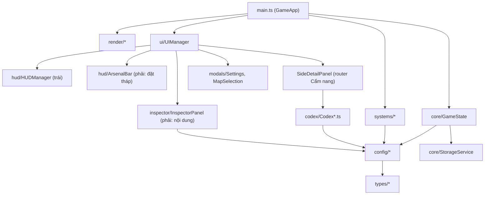

# Kiến trúc dự án Stick Vanguard

## Stack

- **TypeScript 5** (strict), **Vite 5** (dev/build), **Vitest 1** (test), **Canvas 2D** (render game).
- Không framework UI: DOM thao tác trực tiếp, HTML khung trong `index.html`, nội dung động render bằng template string.
- Deploy: Cloudflare Workers static assets (`wrangler.json`, `npm run deploy` → build `dist/` rồi `wrangler deploy`).

| Lệnh | Tác dụng |
|---|---|
| `npm run dev` | Chạy Vite dev server |
| `npm run build` | `tsc && vite build` |
| `npm test` | `vitest run` |
| `npx tsc --noEmit` | Type-check nhanh |

## Cấu trúc thư mục

```
index.html                 # Khung layout: #left-panel | #canvas-stage | #right-panel | 3 modal
src/
├── main.ts                # GameApp: khởi tạo, game loop (update/render), input canvas
├── style.css              # Toàn bộ CSS
├── types/                 # Kiểu dùng chung
│   ├── elements.types.ts  #   ElementType (15 hệ), StatusEffectType, MovementType, NavigationMode, DamagePayload
│   └── entities.types.ts  #   TowerType, TowerEntity, EnemyEntity, SoldierEntity, Projectile, Particle…
├── config/                # DỮ LIỆU TĨNH (nguồn sự thật duy nhất)
│   ├── towers.config.ts   #   TOWER_BLUEPRINTS + DEFENSE/SUMMON/TRAP_TOWER_TYPES
│   ├── elements.config.ts #   re-export → elements/index.ts
│   ├── elements/          #   *.element.ts (15 hệ), reactions.config.ts, icons/*.svg, types.ts
│   ├── enemies.config.ts  #   re-export → enemies/index.ts
│   ├── enemies/           #   ground/flying/aquatic/elite/boss/minion.enemies.ts, cc.config.ts, types.ts
│   ├── map.config.ts      #   MapConfig/WaveConfig types + helper lanes/bases, re-export MAPS_CONFIG
│   └── maps/              #   *.map.ts (10 map), waves_extended.ts, index.ts (MAPS_CONFIG)
├── core/
│   ├── GameState.ts       # Toàn bộ trạng thái trận + build/upgrade/downgrade/sell/rally/buffs
│   └── StorageService.ts  # localStorage (cài đặt trận)
├── systems/               # Logic gameplay (static class)
│   ├── WaveSystem.ts          # Sinh quái theo đợt, scaling sau đợt 10
│   ├── NavigationSystem.ts    # Đường đi WALK/FLY/SWIM theo lane
│   ├── EnemySkillSystem.ts    # Kỹ năng quái (SUMMON, DEATH_SPAWN, DISABLE_TOWER, aura…)
│   ├── TrapSystem.ts          # Bẫy trên đường/sông
│   ├── CombatSystem.ts        # Lính triệu hồi đánh quái
│   ├── TowerSystem.ts         # Tháp chọn mục tiêu & bắn
│   ├── ProjectileSystem.ts    # Đạn bay & va chạm
│   ├── TargetingRuleEngine.ts # canTarget, công thức sát thương, khắc chế nguyên tố, status effect, CC
│   └── SoundSystem.ts         # Âm thanh tổng hợp thủ tục (WebAudio)
├── render/                # Vẽ canvas (static class)
│   ├── MapRenderer.ts           # Nền, đường, sông, căn cứ, phản hồi đặt tháp
│   ├── TowerRenderer.ts         # Tháp, đạn, hạt
│   ├── StickmanRenderer.ts      # Lính & quái dạng người que
│   └── EnemyArchetypeRenderer.ts# Hình dạng quái theo archetype (DRAGON, SERPENT, SLIME…)
├── ui/
│   ├── UIManager.ts       # Điều phối UI, phím tắt, trigger Codex
│   ├── SideDetailPanel.ts # Router Cẩm nang (modal #codex-modal-backdrop)
│   ├── codex/             # Nội dung từng tab Cẩm nang
│   ├── hud/               # HUDManager (panel trái), ArsenalBar (panel phải – đặt tháp)
│   ├── inspector/         # InspectorPanel (nội dung panel phải)
│   └── modals/            # SettingsModal, MapSelectionModal
└── __tests__/             # Vitest
```

## Sơ đồ phụ thuộc



Quy tắc chiều phụ thuộc: `types` ← `config` ← `core`/`systems`/`render` ← `ui` ← `main`.
`config` **không** được import từ `ui`, `systems`, `core`. (Ngoại lệ hiện có: `CodexEnemies`
dùng renderer + `TargetingRuleEngine` để vẽ animation & tính bảng khắc chế.)

## Game loop (`src/main.ts`)

`loop()` → `update(dt)` (`dt` giới hạn 0.1s × `state.gameSpeed`; bỏ qua khi `isPaused`, `isGameOver`, `isVictory`)
→ `render()` (luôn chạy) → `uiManager.updateHUD(...)` (luôn chạy, InspectorPanel dùng key cache để không dựng lại DOM thừa).

Thứ tự `update(dt)`:
1. Đồng bộ cài đặt (`customTotalWaves`, `TargetingRuleEngine.globalDamageMultiplier`).
2. `WaveSystem.update` – sinh quái, thưởng vàng hết đợt, xét thắng.
3. `EnemySkillSystem.update` + di chuyển quái theo `NavigationSystem`, xử lý chết (`handleDeath`), quái chạm căn cứ (trừ máu, xét thua).
4. `TrapSystem.updateTraps`.
5. `CombatSystem.updateCombat` (lính ↔ quái).
6. `TowerSystem.updateTowers` (sinh đạn).
7. `ProjectileSystem.updateProjectiles` (va chạm, sát thương qua `TargetingRuleEngine`).
8. Cập nhật hạt / text nổi.

Thứ tự `render()`: `MapRenderer.renderBackground` → `TowerRenderer.renderTowers` → quái mặt đất/nước →
lính → quái bay → `MapRenderer.renderPlacementFeedback` → đạn → hạt.

Các hành động người chơi (xây, nâng cấp, bán, đặt rally) đi qua method của `GameState`
được gọi từ `main.ts#bindCanvasEvents` hoặc `InspectorPanel`.

## Muốn thêm X thì đặt ở đâu

| Muốn thêm | Đặt ở | Ghi chú |
|---|---|---|
| Hằng số cân bằng (giá, sát thương, tỉ lệ) | `src/config/` | Không đặt trong systems/ui |
| Kiểu dữ liệu mới dùng nhiều nơi | `src/types/` | |
| Cơ chế gameplay mới chạy mỗi frame | `src/systems/NewSystem.ts` (static) | Gọi trong `main.ts#update` đúng thứ tự |
| Công thức sát thương / hiệu ứng trạng thái | `src/systems/TargetingRuleEngine.ts` | Test ở `architecture.test.ts` |
| Hành động người chơi (mua, bán, đổi chế độ) | method public trong `GameState` | UI chỉ gọi method, không tự sửa state phức tạp |
| Hình vẽ canvas | `src/render/*Renderer.ts` | |
| Phần tử panel trái | `index.html` `#left-panel` + `HUDManager` | |
| Phần tử panel phải | `InspectorPanel` (render) + `ArsenalBar` (trạng thái đặt) | |
| Modal mới | `src/ui/modals/` + backdrop trong `index.html` + khởi tạo trong `UIManager` + đóng bằng ESC trong `bindKeyboard` | |
| Tab/mục Cẩm nang | `src/ui/codex/` + nhánh trong `SideDetailPanel.open/renderContent` + nút `.codex-tab` trong `index.html` | |

## File lớn – đọc theo đoạn

| File | Dòng (≈) | Mẹo |
|---|---|---|
| `src/__tests__/architecture.test.ts` | 3000 | `grep -n "describe("` để tìm nhóm test |
| `src/render/EnemyArchetypeRenderer.ts` | 1430 | map `typeId` → archetype ở đầu file |
| `src/core/GameState.ts` | 1260 | `grep -n "public "` |
| `src/ui/inspector/InspectorPanel.ts` | 1190 | `grep -n "private render\|public "` |
| `src/systems/SoundSystem.ts` | 890 | `grep -n "static play"` |
| `src/systems/TargetingRuleEngine.ts` | 850 | `grep -n "public static"` |
| `src/ui/codex/CodexBuildings.ts`, `CodexSoldiers.ts`, `CodexEnemies.ts` | 800 | `grep -n "public \|private "` |
| `src/config/towers.config.ts` | 780 | `grep -n "'[A-Z_0-9]*': {"` |

## Nợ kỹ thuật đã biết

- `ArsenalBar` vẫn query `.hotbar-btn` nhưng `index.html` không còn phần tử này
  (danh sách tháp giờ là `.build-option` do `InspectorPanel` render). Đừng thêm logic mới dựa vào `.hotbar-btn`.
- `ALL_15_ELEMENTS` / `STATUS_TO_ELEMENT` trùng giữa `ui/codex/CodexTypes.ts` và `config/elements/index.ts`.
- `SideDetailPanel` gán `window.__openCodexCategory` để mở Cẩm nang từ HTML inline.
