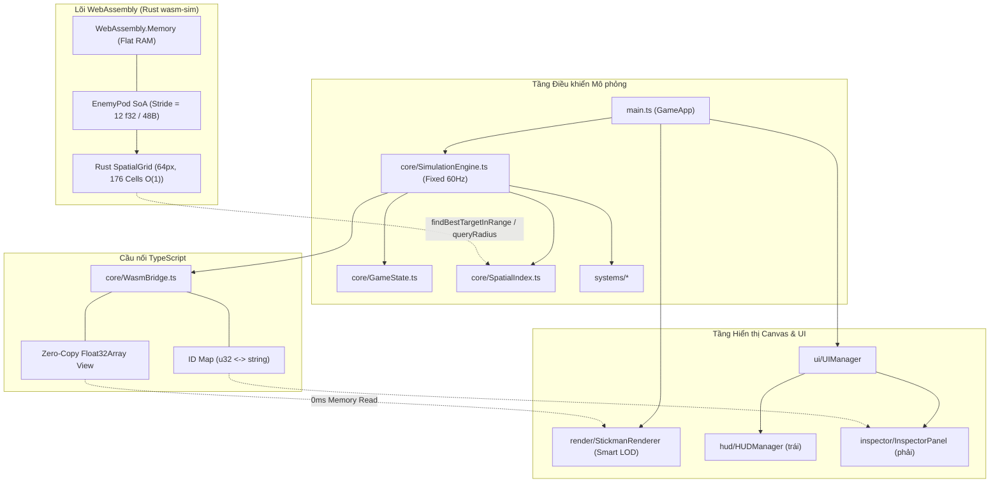

# Kiến trúc dự án Stick Vanguard

## Stack

- **TypeScript 5** (strict), **Vite 5** (dev/build), **Vitest 1** (test), **Canvas 2D** (render game).
- **WebAssembly Core (Rust)**: Crate `wasm-sim/` biên dịch bằng `wasm-bindgen`, tối ưu SIMD/L2 Cache phẳng và tính toán không gian.
- Không framework UI: DOM thao tác trực tiếp, HTML khung trong `index.html`, nội dung động render bằng template string.
- Deploy: Cloudflare Workers static assets (`wrangler.json`, `npm run deploy` → build `dist/` rồi `wrangler deploy`).

| Lệnh | Tác dụng |
|---|---|
| `npm run dev` | Chạy Vite dev server |
| `npm run build:wasm` | Biên dịch Rust crate `wasm-sim` sang `src/wasm/` |
| `npm run build` | `tsc && vite build` (đóng gói production cả JS và WASM) |
| `npm test` | Chạy toàn bộ 10 file Vitest suite |
| `npx tsc --noEmit` | Type-check nhanh toàn bộ TypeScript |

## Cấu trúc thư mục

```
index.html                 # Khung layout: #left-panel | #canvas-stage | #right-panel | 3 modal
wasm-sim/                  # MÃ NGUỒN RUST WEB ASSEMBLY
├── Cargo.toml             #   Cấu hình crate cdylib, wasm-bindgen 0.2, release opt-level=3, LTO
└── src/lib.rs             #   EnemyPod SoA flat layout, SpatialGrid Rust, path kinematics, zero-copy buffers
src/
├── main.ts                # GameApp: khởi tạo, WASM bootstrap, game loop (update/render), input canvas
├── style.css              # Toàn bộ CSS
├── wasm/                  # BINDING WASM ĐƯỢC SINH TỰ ĐỘNG
│   ├── wasm_sim.js        #   ES module bindings cho WebAssembly
│   └── wasm_sim_bg.wasm   #   File binary wasm (42 KB)
├── types/                 # Kiểu dùng chung
│   ├── elements.types.ts  #   ElementType (15 hệ), StatusEffectType, MovementType, NavigationMode, DamagePayload
│   └── entities.types.ts  #   TowerType, TowerEntity, EnemyEntity, SoldierEntity, Projectile, Particle…
├── config/                # DỮ LIỆU TĨNH (nguồn sự thật duy nhất)
│   ├── towers.config.ts   #   TOWER_BLUEPRINTS + DEFENSE/SUMMON/TRAP_TOWER_TYPES
│   ├── elements.config.ts #   re-export → elements/index.ts
│   ├── elements/          #   *.element.ts (15 hệ), reactions.config.ts, icons/*.svg, types.ts
│   ├── enemies.config.ts  #   re-export → enemies/index.ts
│   ├── enemies/           #   ground/flying/aquatic/elite/boss/minion.enemies.ts, cc.config.ts, types.ts
│   ├── map.config.ts      #   MapConfig/WaveConfig types + helper lanes/bases, re-export MAPS_CONFIG
│   └── maps/              #   *.map.ts (10 map), waves_extended.ts, index.ts (MAPS_CONFIG)
├── core/
│   ├── GameState.ts       # Toàn bộ trạng thái trận + build/upgrade/downgrade/sell/rally/buffs
│   ├── StorageService.ts  # localStorage (cài đặt trận)
│   ├── WasmBridge.ts      # Cầu nối Zero-Copy Direct Float32Array View & bản đồ ID 2 chiều
│   ├── SimulationEngine.ts# Vòng lặp mô phỏng Fixed 60Hz loop, sub-stepping, nội suy alpha
│   ├── SpatialIndex.ts    # Lưới băm không gian O(1) 64px, tìm mục tiêu & AoE trúng đích
│   └── ObjectPool.ts      # Generic ObjectPool, swapRemove O(1), particlePool, floatingTextPool
├── systems/               # Logic gameplay (static class)
│   ├── WaveSystem.ts          # Sinh quái theo đợt, scaling sau đợt 10
│   ├── NavigationSystem.ts    # Đường đi WALK/FLY/SWIM theo lane
│   ├── EnemySkillSystem.ts    # Kỹ năng quái (SUMMON, DEATH_SPAWN, DISABLE_TOWER, aura…)
│   ├── TrapSystem.ts          # Bẫy trên đường/sông
│   ├── CombatSystem.ts        # Lính triệu hồi đánh quái
│   ├── TowerSystem.ts         # Tháp chọn mục tiêu & bắn
│   ├── ProjectileSystem.ts    # Đạn bay & va chạm
│   ├── TargetingRuleEngine.ts # canTarget, công thức sát thương, khắc chế nguyên tố, status effect, CC
│   └── SoundSystem.ts         # Âm thanh tổng hợp thủ tục (WebAudio)
├── render/                # Vẽ canvas (static class)
│   ├── MapRenderer.ts           # Nền, đường, sông, căn cứ, cache địa hình tĩnh Offscreen Canvas
│   ├── TowerRenderer.ts         # Tháp, đạn, hạt gom nhóm batch draw
│   ├── StickmanRenderer.ts      # Lính & quái dạng người que, Smart LOD (FULL, MEDIUM, HIGH_CROWD)
│   ├── UnitSpriteCache.ts       # Bộ nhớ đệm Procedural Sprite Atlas nướng sẵn quái stickman
│   └── EnemyArchetypeRenderer.ts# Hình dạng quái theo archetype (DRAGON, SERPENT, SLIME…)
├── ui/
│   ├── UIManager.ts       # Điều phối UI, phím tắt, trigger Codex
│   ├── SideDetailPanel.ts # Router Cẩm nang (modal #codex-modal-backdrop)
│   ├── codex/             # Nội dung từng tab Cẩm nang
│   ├── hud/               # HUDManager (panel trái), ArsenalBar (panel phải – đặt tháp)
│   ├── inspector/         # InspectorPanel (nội dung panel phải)
│   └── modals/            # SettingsModal, MapSelectionModal
└── __tests__/             # Vitest (10 files)
```

## Sơ đồ phụ thuộc & Tối ưu hóa



Quy tắc chiều phụ thuộc: `types` ← `config` ← `wasm`/`core`/`systems`/`render` ← `ui` ← `main`.
`config` **không** được import từ `ui`, `systems`, `core`.

## Game loop & Fixed Timestep (`src/main.ts` & `SimulationEngine.ts`)

- `main.ts` nhận `requestAnimationFrame` và chuyển thời gian thực `rawDt` vào `SimulationEngine.update(rawDt)`.
- `SimulationEngine` tích lũy thời gian vào accumulator:
  - Chạy các bước mô phỏng cố định 60Hz (`fixedDt = 1/60s`).
  - Hạn chế tối đa 4 sub-steps mỗi frame để ngăn hiện tượng "spiral of death".
  - Tính toán `interpolationAlpha` để `StickmanRenderer` nội suy toạ độ giữa `prevX/prevY` và `x/y`, đảm bảo hình ảnh cực kỳ mượt mà kể cả trên màn hình 120Hz/144Hz.
- Vòng lặp `tick(fixedDt)`:
  1. Đồng bộ cài đặt (`customTotalWaves`, `damageMultiplier`).
  2. Ghi nhận toạ độ khung hình trước `recordPreviousPositions()`.
  3. Xây dựng lại lưới không gian ban đầu `SpatialIndex.rebuild()`.
  4. `WaveSystem.update` – sinh quái (gọi `wasmBridge.spawnEnemy` nếu có WASM).
  5. `EnemySkillSystem.update` – xử lý aura và kỹ năng.
  6. `updateEnemies(dt)`:
     - Nếu có WASM: chạy `wasmBridge.stepSimulation(dt, animTime)` di chuyển toàn bộ quái trong linear memory.
     - Xử lý quái chết hoặc chạm căn cứ (thu hồi ID qua `wasmBridge.removeEnemy`).
     - Tái đồng bộ lưới không gian `wasmBridge.rebuildSpatialGrid()`.
  7. `TrapSystem.updateTraps` – bẫy kích hoạt sát thương lan.
  8. `CombatSystem.updateCombat` – lính cận chiến và tầm xa chiến đấu.
  9. `TowerSystem.updateTowers` – tháp tìm mục tiêu qua lưới không gian và sinh đạn.
  10. `ProjectileSystem.updateProjectiles` – cập nhật đạn bay và nổ diện rộng.
  11. Cập nhật hạt và chữ nổi qua `ObjectPool` và `swapRemove` $O(1)$.

## Muốn thêm X thì đặt ở đâu

| Muốn thêm | Đặt ở | Ghi chú |
|---|---|---|
| Hằng số cân bằng (giá, sát thương, tỉ lệ) | `src/config/` | Không đặt trong systems/ui |
| Kiểu dữ liệu mới dùng nhiều nơi | `src/types/` | |
| Cơ chế tính toán nặng trên số lượng lớn quái | `wasm-sim/src/lib.rs` | Sửa xong chạy `npm run build:wasm` |
| Cầu nối dữ liệu WASM ↔ JS | `src/core/WasmBridge.ts` | Giữ nguyên khả năng Fallback |
| Cơ chế gameplay mới chạy mỗi tick | `src/systems/NewSystem.ts` (static) | Gọi trong `SimulationEngine.ts#tick` |
| Công thức sát thương / hiệu ứng trạng thái | `src/systems/TargetingRuleEngine.ts` | Test ở `architecture.test.ts` |
| Hành động người chơi (mua, bán, đổi chế độ) | method public trong `GameState` | UI chỉ gọi method, không tự sửa state phức tạp |
| Hình vẽ canvas & tối ưu LOD | `src/render/*Renderer.ts` | Tuân thủ LOD level và Atlas cache |
| Phần tử panel trái | `index.html` `#left-panel` + `HUDManager` | |
| Phần tử panel phải | `InspectorPanel` (render) + `ArsenalBar` (trạng thái đặt) | |
| Modal mới | `src/ui/modals/` + backdrop trong `index.html` + khởi tạo trong `UIManager` | |
| Tab/mục Cẩm nang | `src/ui/codex/` + nhánh trong `SideDetailPanel.open/renderContent` | |

## File lớn – đọc theo đoạn

| File | Dòng (≈) | Mẹo |
|---|---|---|
| `src/__tests__/architecture.test.ts` | 3000 | `grep -n "describe("` để tìm nhóm test |
| `src/render/EnemyArchetypeRenderer.ts` | 1430 | map `typeId` → archetype ở đầu file |
| `src/core/GameState.ts` | 1260 | `grep -n "public "` |
| `src/ui/inspector/InspectorPanel.ts` | 1190 | `grep -n "private render\|public "` |
| `src/systems/SoundSystem.ts` | 890 | `grep -n "static play"` |
| `src/systems/TargetingRuleEngine.ts` | 850 | `grep -n "public static"` |
| `wasm-sim/src/lib.rs` | 690 | `SimulationWorld`, `step_simulation`, `query_radius` |
| `src/render/StickmanRenderer.ts` | 640 | `renderEnemy`, `renderSoldier`, `getLODLevel` |
| `src/config/towers.config.ts` | 780 | `grep -n "'[A-Z_0-9]*': {"` |
