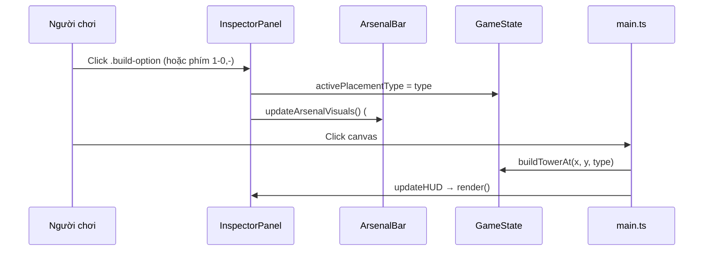

# Bố cục UI & Panel

## Bố cục `index.html`

```
#game-container
├── <aside #left-panel>      PANEL TRÁI   → src/ui/hud/HUDManager.ts
├── <main #canvas-stage>     GIỮA         → canvas #game-canvas (main.ts) + overlay
├── <aside #right-panel>     PANEL PHẢI   → src/ui/hud/ArsenalBar.ts + src/ui/inspector/InspectorPanel.ts
├── #codex-modal-backdrop    CẨM NANG     → src/ui/SideDetailPanel.ts (+ src/ui/codex/*)
├── #map-modal-backdrop      CHỌN MAP     → src/ui/modals/MapSelectionModal.ts
└── #settings-modal-backdrop CÀI ĐẶT      → src/ui/modals/SettingsModal.ts
```

Tất cả được khởi tạo trong `src/ui/UIManager.ts`; `main.ts` gọi `uiManager.updateHUD(...)` mỗi frame.

## Panel trái – `src/ui/hud/HUDManager.ts`

| DOM id | Chức năng | Xử lý bởi |
|---|---|---|
| `#hud-gold`, `#hud-lives`, `#hud-wave`, `#hud-wave-hp-buff` | Vàng, máu căn cứ, đợt, buff máu quái | `HUDManager.updateHUD` |
| `#btn-next-wave` | Gọi đợt quái (callback `onCallWave` → `main.ts#handleCallWave`) | `HUDManager` |
| `#btn-select-map` | Mở modal chọn bản đồ | `MapSelectionModal` |
| `#btn-open-settings-modal` | Mở modal cài đặt | `SettingsModal` |
| `#btn-codex` | Mở/đóng Cẩm nang | `UIManager.bindCodexTriggers` |
| `.left-panel-footer` | Dòng phím tắt (cập nhật khi đổi phím) | tĩnh trong `index.html` |

HUDManager cũng quản lý phần **overlay trên canvas** và **banner**:

| DOM id | Chức năng |
|---|---|
| `#btn-sound-toggle` | Bật/tắt âm (phím M → `HUDManager.toggleSound`) |
| `#btn-speed`, `#btn-pause`, `#btn-restart`, `#btn-fullscreen` | Tốc độ, tạm dừng, chơi lại, toàn màn hình |
| `#message-banner` (+ `#btn-banner-restart`, `#btn-banner-next-map`, `#btn-banner-change-map`) | Banner thắng/thua (`updateMessageBanner`, `clearBanner`) |
| `#hud-map-name`, `#hud-map-waves` | Tên map / số đợt (nếu có trong DOM) |

Callback interface: `HUDCallbacks { onCallWave, onRestart, onOpenMapModal, onSelectMap }`.

## Panel phải – `ArsenalBar.ts` + `InspectorPanel.ts`

### `src/ui/hud/ArsenalBar.ts` – trạng thái chọn/đặt tháp
- Bật/tắt `state.activePlacementType` (reset `selectedSlotId`, `selectedTowerId`, `selectedBuildPoint`, `isSettingRallyPoint`).
- `updateArsenalVisuals()`: trạng thái active/disabled theo vàng; cập nhật dòng gợi ý **`#placement-hint`**
  (thanh nổi trên canvas) theo 3 trạng thái: đang đặt tháp / đã chọn toạ độ / mặc định.
- `getLiveSummonedUnits(towerId)`: lấy lính đang sống của một tháp triệu hồi.
- Callback `onPlacementChanged` → `InspectorPanel.handleResize()` (vẽ lại panel phải).
- ⚠️ Selector `.hotbar-btn` là di sản – không còn trong DOM.

### `src/ui/inspector/InspectorPanel.ts` – nội dung `#right-panel`
| DOM | Chức năng |
|---|---|
| `#btn-choose-tower` | Tab "Chọn Tháp" (`openChooseTower`) |
| `#btn-stage-info` | Tab "Màn Chơi" (`openStageInfo`, cũng được bind ở `UIManager.bindStageInfoTrigger`) |
| `#inspector-main-title` | Tiêu đề panel |
| `#inspector-content` | Nội dung động: danh sách `.build-option[data-type]` (phòng ngự / triệu hồi / bẫy), chi tiết tháp đang chọn, nâng cấp/nhánh 4A-4B, khảm nguyên tố, đổi chế độ lính, bán, rally point, danh sách lính triệu hồi trực tiếp (`renderSummonedUnitsSectionHtml`, `updateLiveSummonedUnits`), thông tin màn chơi & đợt quái |
| `#menu-overlay` | Menu nổi trên canvas khi chọn tháp/điểm xây |

- `render()` được gọi mỗi frame qua `UIManager.updateHUD` → tránh dựng lại DOM khi không cần
  (giữ scroll/hover); sau khi đổi state từ ngoài thì gọi `handleResize()` để buộc vẽ lại.
- Callback `onArsenalChanged` → `ArsenalBar.updateArsenalVisuals()`; `onOpenMapModal` → mở modal map.

## Luồng tương tác chính



## Phím tắt – `UIManager.bindKeyboard`

| Phím | Hành động |
|---|---|
| `ESC` | Đóng Cẩm nang → modal map → modal cài đặt → huỷ đặt tháp/rally/chọn |
| `Space` | Gọi đợt |
| `B` / `C` | Mở/đóng Cẩm nang |
| `M` | Bật/tắt âm |
| `1`–`7` | ARCHER, MAGE, ARTILLERY, BARRACKS, DRAGON_NEST, FAIRY_TREE, HEROIC_ALTAR |
| `8`, `9`, `0`, `-` | TRAP_SPIKE, TRAP_FIRE, TRAP_FROST, TRAP_NET |

Đổi phím → cập nhật cả `keyMap`, footer `index.html`, `title` của nút, text gợi ý trong `ArsenalBar`.

## Checklist khi sửa UI
- Thêm phần tử tĩnh → `index.html` + style trong `src/style.css`; bind trong class phụ trách (bảng trên).
- Thêm nội dung động panel phải → `InspectorPanel`; panel trái → `HUDManager.updateHUD`.
- Modal mới → thêm nhánh đóng bằng ESC trong `UIManager.bindKeyboard`.
- Text tiếng Việt, giữ phong cách emoji hiện có.

